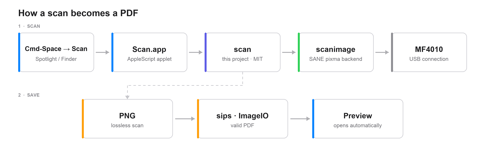

# Canon MF4010 scanning on modern macOS

[](https://github.com/zvdenis/canon-mf4010-macos/actions/workflows/ci.yml)
[](https://github.com/zvdenis/canon-mf4010-macos/releases)
[](LICENSE)
[](#requirements)

**Turn a Canon imageCLASS MF4010 back into a working scanner on macOS 12+ —
Apple Silicon included — with one command.**

Canon's ScanGear driver for this printer is 32-bit code that no modern macOS can
run, so Image Capture and Preview see nothing. This project drives the scanner
through SANE's `pixma` backend, adds a CLI with sane defaults and a
Spotlight-launchable app, and works around a `scanimage` bug that makes scans
look blank white.



```sh
# CLI only
brew install zvdenis/tap/canon-mf4010

# CLI + Spotlight app
curl -fsSL https://raw.githubusercontent.com/zvdenis/canon-mf4010-macos/main/install.sh | bash
```

Then put a page face-down on the glass and run `scan` (or press ⌘Space, type
`Scan`, Return).

---

**Contents:** [Why](#why-this-exists) · [Install](#install) · [Use](#use) ·
[The blank-page bug](#the-blank-page-bug-this-works-around) ·
[Troubleshooting](#troubleshooting) · [FAQ](#faq) · [Uninstall](#uninstall) ·
[License](#license) · [Русский](README.ru.md)

## Why this exists

The MF4010 is a printer + flatbed scanner + copier from the late 2000s. Printing
still works on macOS through Canon's UFR II driver, but scanning does not: the
scanner half needs **ScanGear MF**, which is 32-bit Intel code. macOS dropped
32-bit apps in Catalina, and no Apple Silicon build exists.

The hardware itself is fine — it exposes a standard Canon scanner interface over
USB. [SANE](https://www.sane-project.org/)'s `pixma` backend supports it, but
that gives you a terminal tool with a dozen options and, on macOS, PDFs that
render as blank pages. This project is the missing glue.

## What you get

- **`scan`** — one command, sensible defaults (A4, 300 dpi, grayscale, PDF).
- **Scan.app** — press ⌘Space, type `Scan`, Return; the page opens in Preview.
- **`install.sh` / `uninstall.sh`** — no sudo, no kernel extensions.
- **Homebrew formula** — `brew install zvdenis/tap/canon-mf4010`.

## Requirements

- macOS 12 or newer (tested on 26.6.2, Apple M5; Intel Macs should work)
- [Homebrew](https://brew.sh)
- The printer connected over USB (this model has no network port)
- No Xcode command line tools needed

## Install

### Homebrew (CLI only)

```sh
brew install zvdenis/tap/canon-mf4010
```

Add the Spotlight app afterwards:

```sh
cp -R "$(brew --prefix)/opt/canon-mf4010/Scan.app" /Applications/
```

### One-liner (CLI + app)

```sh
curl -fsSL https://raw.githubusercontent.com/zvdenis/canon-mf4010-macos/main/install.sh | bash
```

Installs SANE via Homebrew if missing, puts `scan` on your `PATH`, and builds
`Scan.app` in `/Applications` (or `~/Applications` without admin rights).

### From a clone

```sh
git clone https://github.com/zvdenis/canon-mf4010-macos.git
cd canon-mf4010-macos
./install.sh
```

Installer options: `--prefix DIR`, `--app-dir DIR`, `--no-app`, `--no-brew`.

## Use

### Spotlight and Finder

⌘Space → `Scan` → Return. It scans one page, saves it to `~/Documents/Scans`,
and opens the result in Preview. Put the page **face-down on the glass** first —
scanning starts immediately.

If the scanner is asleep or unplugged, the app shows the error dialog instead of
failing silently. Details go to `/tmp/scan-app.log`.

### Command line

```sh
scan                    # 300 dpi grayscale PDF -> ~/Documents/Scans
scan -c                 # color
scan -c -r 150          # fast color draft
scan -l -n Receipt      # black & white, custom file name
scan -p 3               # 3 pages, prompts you to swap pages
scan --png -o ~/Desktop/page.png
scan --list             # show detected scanners
scan --version
```

| Option | Meaning |
|---|---|
| `-c`, `--color` | Color scan (default: grayscale) |
| `-l`, `--lineart` | Pure black & white, best for text |
| `-r 75/150/300/600` | Resolution (default: 300 dpi) |
| `-p N` | Scan N pages, prompting between pages |
| `-o FILE` | Exact output path |
| `-n NAME` | File name base |
| `--png`, `--jpg`, `--tiff` | Output format (default: PDF) |
| `--no-open` | Do not open the result |
| `SCAN_DIR=...` | Change the output folder |

Output: `Scan-YYYY-MM-DD-HHMMSS.pdf`, 300 dpi grayscale by default. The full
A4 bed is scanned (the MF4010 has no page-size sensor); crop afterwards if you
need exact page boundaries.

## How it works

```
Spotlight ──► Scan.app ──► scan ──► scanimage ──► SANE pixma ──► MF4010 (USB)
                                   │
                                   └──► PNG ──► sips (ImageIO) ──► PDF ──► Preview
```

- `scanimage` talks to the scanner through SANE's `pixma` backend
  (`pixma:04A926B4_<serial>`); the device is auto-detected, no serial is stored
  in this repo.
- `scan` scans to PNG and converts to PDF with `sips` (macOS ImageIO), which
  writes a correct cross-reference table.
- `Scan.app` is a small AppleScript applet that runs `scan` and reports failures
  in a dialog.

Tested against a Canon imageCLASS MF4010 Series over USB, macOS 26.6.2 (25G83),
Apple M5, SANE 1.4.0, and Canon UFR II 10.19.25 for printing.

| Model | Status |
|---|---|
| imageCLASS MF4010 | Tested |
| MF4018, MF4120, MF4122, MF4140, MF4150, MF4270, MF4350d, MF4370dn, MF4380dn | Listed in `sane-pixma`; likely work, untested |

## The blank-page bug this works around

`scanimage --format=pdf` in SANE 1.4.0 writes a PDF whose cross-reference table
is all zeros, with `startxref 0`. The scanned image is inside the file and valid,
but CoreGraphics (Preview, Quick Look, PDFKit) refuses to draw it and logs:

```
CoreGraphics PDF has logged an error
```

The page then looks blank white. Other readers silently repair the file, which
makes the problem look intermittent. `scan` avoids that writer entirely: it
scans a lossless PNG and builds the PDF with macOS ImageIO.

The upstream write-up, with a minimal reproduction, is in
[docs/upstream-report.md](docs/upstream-report.md). A fix in SANE would make
this workaround unnecessary for everyone, not just MF4010 users.

## Troubleshooting

| Symptom | What to do |
|---|---|
| `scan: no Canon scanner found` | Printer off or asleep — press a button on it, check the USB cable, run `scan --list`. The MF4010 sometimes drops off USB when idle; a button press brings it back. |
| Page is white in Preview | Make sure the sheet is face-down on the glass. PDFs created before 0.1.0 were malformed — rescan with the current version. |
| Scan hangs / device busy | Unplug and replug USB, wait ~10 s, retry. Print jobs share the USB link. |
| Streaks or gray background | Clean the platen glass; Canon's driver-side calibration isn't available through SANE. |
| App seems to do nothing | Check `/tmp/scan-app.log`; run `scan` in Terminal to see the error. |
| `brew` can't link `scan` | An older copy exists in `/opt/homebrew/bin`; remove it, then `brew link canon-mf4010`. |

## FAQ

**Does it work with other Canon models?**
Only the MF4010 is tested. Other models listed in `man sane-pixma` (MF4018,
MF4120, MF4150, ...) share the protocol and will likely work; try
`scan --list` and report back.

**Why not VueScan?**
VueScan supports the MF4010 and is excellent, but it's paid: $49.95 for the
Basic edition (JPEG only — no PDF) or $99.95 for Standard with PDF/OCR. If you
want a GUI, OCR and film scanning, buy it. This project covers the common case
— free, MIT, scriptable, and installable with one command.

**What about ExactScan?**
Its Canon support covers P-, DR-, G- and X-series document scanners; the MF4010
is not in its compatibility list.

**Can I scan to OCR/searchable PDF?**
Not built in. Save a PDF and run it through `ocrmypdf` (Homebrew), or use
VueScan/ExactScan.

**ADF, duplex, network?**
The MF4010 has none of those. Multi-page means `scan -p N` and swapping sheets.

**Is the scan quality good?**
600 dpi color is available but slow (~1–2 min/page). 300 dpi grayscale is the
sweet spot for documents.

## Uninstall

```sh
# Homebrew CLI
brew uninstall canon-mf4010

# install.sh version
./uninstall.sh

# Spotlight app (either method)
rm -rf /Applications/Scan.app
```

Your scans in `~/Documents/Scans` are never touched. To remove the driver as
well: `brew uninstall sane-backends`.

## Contributing

Issues and PRs are welcome, especially:

- reports from other `sane-pixma`-supported Canon MFPs,
- a native Swift/AppKit frontend (the AppleScript app is deliberately minimal),
- help getting the PDF bug fixed upstream.

Run `shellcheck scan install.sh uninstall.sh` before sending a PR; CI runs the
same check.

Not affiliated with Canon. SANE is GPL-2.0; this wrapper is MIT.

## License

MIT — see [LICENSE](LICENSE).
